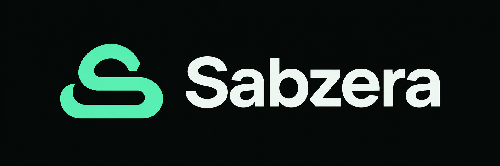
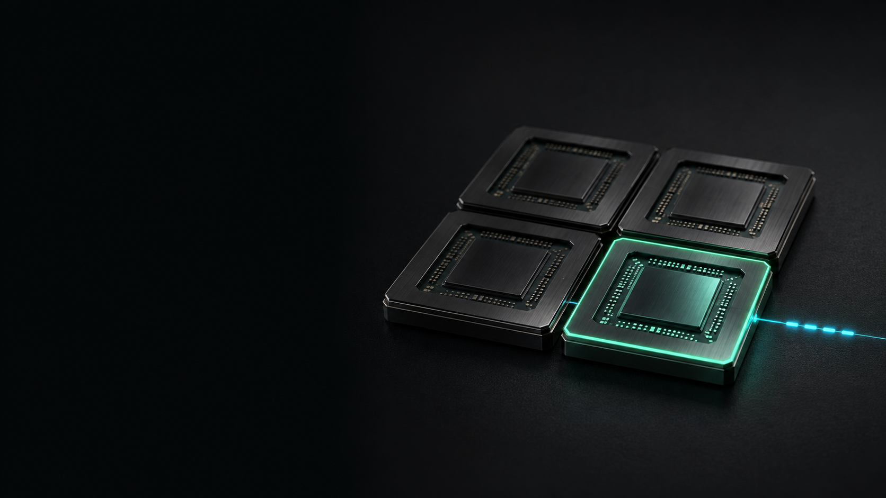

# Sabzera Brand Guidelines



[Identity](#identity) · [Logo](#logo) · [Color](#color) · [Typography](#typography) · [Imagery](#imagery) · [Tailwind tokens](#tailwind-tokens)

## Identity

Sabzera is a multi-tenant serverless AI inference platform designed for low-latency streaming, scale-to-zero GPU capacity, and per-tenant usage and budget controls. Write for AI engineers, platform engineers, developers, and technical leads evaluating production inference.

| Pillar | What it means |
| --- | --- |
| Velocity | Stream responses as tokens arrive and make latency visible. |
| Elasticity | Bring GPU capacity online as demand rises and scale it to zero when idle. |
| Precision | Give each tenant clear spend controls and real-time visibility into requests and tokens per minute. |

### Messaging

Write **Sabzera** in prose and `sabzera` in package names, commands, and paths. Lead with what the developer can do. For performance claims, name the metric and test conditions. For efficiency claims, describe the scale-to-zero behavior or cite measured GPU usage.

| Tagline | Use |
| --- | --- |
| **Inference without idle waste.** | Default brand line |
| **Stream tokens. Scale to zero.** | Technical landing pages and launch copy |
| **GPU capacity that follows traffic.** | Autoscaling and infrastructure pages |
| **Serve models. Control spend.** | Budget-control and enterprise messaging |
| **Intelligence on demand.** | Campaigns and broad introductions |

## Logo

The primary mark is a continuous **S** with the silhouette of a cloud. Its rounded turns and open ends give it a distinct shape at compact sizes.

| Asset | Use | File |
| --- | --- | --- |
| S-cloud mark | Product icon, avatar, compact navigation | [sabzera-logo.png](sabzera-logo.png) |
| Horizontal lockup | GitHub README banner, presentations, dark marketing surfaces | [sabzera-banner.png](sabzera-banner.png) |
| GPU hero | Website hero, launch posts, presentation covers | [sabzera-gpu.png](sabzera-gpu.png) |

- Keep at least one-quarter of the visible mark height as clear space around the mark or lockup. Count built-in padding toward this space.
- Preserve the mark's proportions and the spacing in the supplied lockup. Keep the logo free of effects and overlays.
- Use the supplied lockup on dark backgrounds. For future light-mode artwork, use deep emerald `#006B44` for the mark and carbon text `#12201A` for the wordmark.
- Use the standalone mark for a favicon. Check it at 16 × 16 px and use a dedicated small-size export if the interior gaps close up.
- Use `Sabzera` as alt text when the logo identifies the brand. Use empty alt text when adjacent text already gives the same name.

## Color

Carbon provides the dark foundation. Sabz green highlights primary actions and active compute. Photon cyan indicates live throughput and token streaming.

| Token | Dark | Light | Use |
| --- | --- | --- | --- |
| `background` | `#080C0B` | `#F6FAF8` | Page canvas |
| `surface` | `#101614` | `#FFFFFF` | Cards, tables, and playground |
| `surface-raised` | `#17201C` | `#EAF2EE` | Menus, overlays, and selected rows |
| `border` | `#2B3B34` | `#CFDED6` | Decorative dividers and grid lines |
| `border-strong` | `#5C756A` | `#748B80` | Input outlines and essential boundaries |
| `text` | `#EDF7F2` | `#12201A` | Headings, body copy, and metric values |
| `text-muted` | `#A0B3A9` | `#465B51` | Units, timestamps, and supporting labels |
| `primary` | `#53F5A5` | `#006B44` | Sabz green for actions, focus rings, and active compute |
| `primary-hover` | `#80F9BC` | `#005536` | Primary-action hover |
| `on-primary` | `#07140E` | `#FFFFFF` | Text and icons on filled primary buttons |
| `accent` | `#62DDF5` | `#00677E` | Photon cyan for live RPM/TPM traces and token streams |
| `warning` | `#FFCA70` | `#835000` | Budget thresholds and elevated latency |
| `error` | `#FF819B` | `#A51E42` | Failed requests, exhausted budgets, and hard limits |

Keep routine latency values in `text`. Pair status colors with labels such as **Streaming**, **Near budget**, or **Rate limited**. In both themes, the listed text, action, and status foregrounds reach at least **5.69:1** against the three surfaces. Filled primary buttons reach **6.59:1** or higher with `on-primary`. Essential borders reach at least **3.21:1** against the same surfaces. See [WCAG text contrast](https://www.w3.org/WAI/WCAG22/Understanding/contrast-minimum.html) and [WCAG non-text contrast](https://www.w3.org/WAI/WCAG22/Understanding/non-text-contrast.html).

## Typography

| Role | Family | Guidance | Source |
| --- | --- | --- | --- |
| Display | Instrument Sans | Use 600–700 for headlines and page titles. Start at `-0.035em` tracking on large headlines. | [Google Fonts](https://fonts.google.com/specimen/Instrument+Sans) |
| UI and body | Inter | Use 400 for body, 500 for labels, and 600 for emphasis. Right-align comparable values and enable `tabular-nums` in metric tables. | [Google Fonts](https://fonts.google.com/specimen/Inter) |
| Code | IBM Plex Mono | Use 400–500 for API keys, request IDs, tokens, CLI output, and code. | [Google Fonts](https://fonts.google.com/specimen/IBM+Plex+Mono) |

## Imagery



Use matte carbon, machined graphite, and restrained lighting. In the hero, one mint-lit GPU represents active compute and a cyan pulse represents the token stream. Keep the left 40% clear for live headline text on wide layouts. On narrow layouts, place the headline above the image so the active module stays visible.

## Tailwind tokens

This [Tailwind CSS v4 example](https://tailwindcss.com/docs/theme) defaults to dark. Set `data-theme="light"` on `<html>` to switch. Use classes such as `bg-surface`, `text-text-muted`, `border-border-strong`, and `bg-primary text-on-primary hover:bg-primary-hover`.

```css
@import "tailwindcss";

@theme {
  --color-background:     light-dark(#F6FAF8, #080C0B);
  --color-surface:        light-dark(#FFFFFF, #101614);
  --color-surface-raised: light-dark(#EAF2EE, #17201C);
  --color-border:         light-dark(#CFDED6, #2B3B34);
  --color-border-strong:  light-dark(#748B80, #5C756A);
  --color-text:           light-dark(#12201A, #EDF7F2);
  --color-text-muted:     light-dark(#465B51, #A0B3A9);
  --color-primary:        light-dark(#006B44, #53F5A5);
  --color-primary-hover:  light-dark(#005536, #80F9BC);
  --color-on-primary:     light-dark(#FFFFFF, #07140E);
  --color-accent:         light-dark(#00677E, #62DDF5);
  --color-warning:        light-dark(#835000, #FFCA70);
  --color-error:          light-dark(#A51E42, #FF819B);

  --font-display: "Instrument Sans", system-ui, sans-serif;
  --font-sans: "Inter", system-ui, sans-serif;
  --font-mono: "IBM Plex Mono", ui-monospace, monospace;
}

:root {
  color-scheme: dark;
}

:root[data-theme="light"] {
  color-scheme: light;
}
```

Load the font files through the application's font loader to use the three families above.
